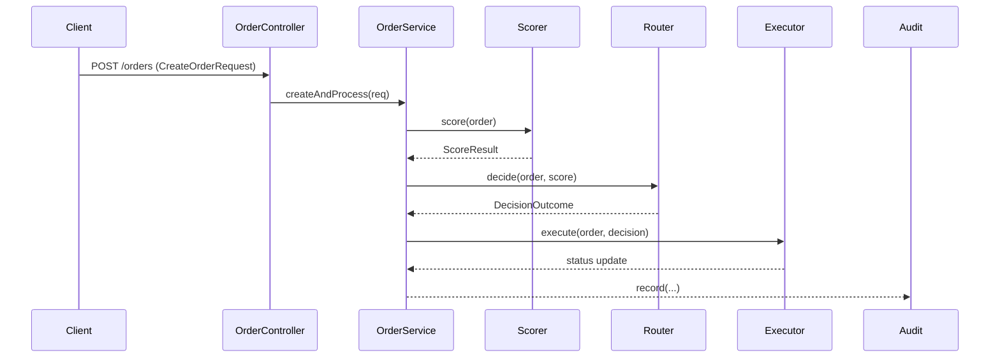
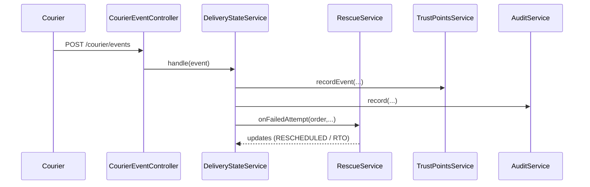
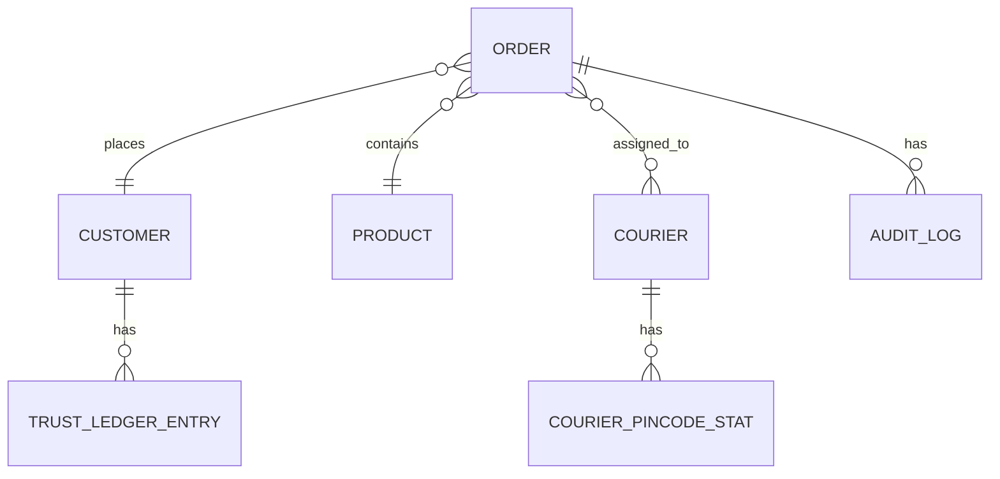

# RTO Shield — Profit-Aware Order Delivery & RTO Recovery


> A rule-driven backend + demo frontend that scores delivery risk, routes orders to profit-aware journeys, and executes low-cost recovery actions to reduce RTO (Return-to-Origin) losses for e-commerce sellers.

---

## Table of Contents

1. [Project Title and Introduction](#1-project-title-and-introduction)
2. [Key Features](#2-key-features)
3. [Problem Statement and Solution](#3-problem-statement-and-solution)
4. [Technology Stack](#4-technology-stack)
5. [Architecture Overview](#5-architecture-overview)
6. [Application Workflows](#6-application-workflows)
7. [Project Structure](#7-project-structure)
8. [Database Design](#8-database-design)
9. [API Documentation](#9-api-documentation)
10. [Swagger API Testing Guide](#10-swagger-api-testing-guide)
11. [How to Run (Quickstart)](#11-how-to-run-quickstart)
12. [Testing](#12-testing)
13. [Contributing](#13-contributing)
14. [TODO / Known Gaps](#14-todo--known-gaps)
15. [Appendix — Useful File Locations](#15-appendix--useful-file-locations)

---

## 1. Project Title and Introduction

**RTO Shield** helps merchants lower failed-delivery (RTO) losses by combining:

- A **deterministic order-health scorer**
- A **profit-aware router** that chooses the best customer journey
- A **rescue engine** that picks low-cost recovery actions

**Intended users:** technical interviewers, developers, and product/ops stakeholders.

**One-line summary:** A compact, demo-ready system that scores order delivery risk, routes orders to profit-aware journeys, and runs recovery/rescue flows to minimize RTO losses.

**Motivation:** Built for interview demos — shows system design, rule-driven business logic, end-to-end flows (intake → scoring → routing → delivery events → recovery → dashboard) and measurable profit outcomes.

---

## 2. Key Features

| Feature | Description |
|---|---|
| Order intake | `POST /orders` and store webhook (`/webhooks/store/order-created`) |
| Order Health Scoring | Rule-based `OrderHealthScorer` produces `healthScore`, `riskLevel`, `scoreReasons` |
| Profit-Aware Routing | `JourneyRouter` + `ProfitCalculator` choose journeys and courier |
| Journey Execution | `JourneyExecutor` sends confirmations and handles customer replies |
| Delivery Events | `POST /courier/events` processes courier status updates |
| Rescue & Recovery | `RescueService` + `RecoveryController` pick low-cost recovery actions |
| Trust Ledger | `TrustPointsService` + `/customers/{id}/trust` (append-only, idempotent) |
| Audit Trail | Every decision recorded via `AuditController` + `AuditLog` entity |
| Simulator | `POST /simulator/run` + `/simulator/reset` runs before/after experiments |
| Frontend Dashboard | React (Vite + Tailwind) visualizes metrics and simulator |
| Demo Endpoint | `POST /demo/run` — one-button 5-step demo for interviews |

> Only features present in code are listed above. Non-implemented items are marked in the [TODO](#14-todo--known-gaps) section.

---

## 3. Problem Statement and Solution

### Problem
High RTO rates reduce seller margins and inventory availability. Standard approaches (one-size-fits-all courier, blanket prepaid offers) don't account for order-level profit trade-offs.

### Solution
Compute an order-level `expectedLoss`, compare with low-cost recovery action costs, and choose journeys or interventions that maximize realized margin. Each decision is **auditable** and **tunable** via `ConfigService`.

**Core idea:** Business rules live in config, not hard-coded. Money math is centralized in `ProfitCalculator`.

---

## 4. Technology Stack

| Technology | Purpose | Location / Where Used |
|---|---|---|
| Java 17, Spring Boot 3.3.5 | Backend framework and DI | `pom.xml`, `src/` |
| Spring Data JPA | Persistence | `src/repo`, `src/domain` |
| PostgreSQL (Docker) | Runtime DB for demo | `docker-compose.yml` |
| Maven | Build tool | `pom.xml` |
| React 18 + Vite + Tailwind | Frontend dashboard | `frontend/` |
| springdoc OpenAPI | API docs (Swagger UI) | Auto-configured from controllers |
| JUnit (spring-boot-starter-test) | Tests | `src/test` |

---

## 5. Architecture Overview

### Major Components

- **API layer:** Controllers under `src/main/java/com/rtoshield/*Controller.java`
- **Service layer:** Scoring, routing, delivery, recovery, simulator
- **Persistence:** JPA entities in `src/domain` and repositories in `src/repo`
- **Frontend:** `frontend/` (React) consumes API

### Mermaid Diagram (Architecture)

```mermaid
flowchart TB
  subgraph Backend
    A[Controllers] --> B(Services)
    B --> C[Repositories (JPA)]
    B --> D[Audit / Trust Ledger]
  end
  F[Frontend (Vite React)] -->|HTTP| A
  G[Postgres Docker] -->|JPA| C
```

---

## 6. Application Workflows

### 6.1 Order Intake → Scoring → Routing → Execution



### 6.2 Delivery Event → Rescue



### 6.3 The 5-Step Demo Flow

1. **Score** — Order health scored
2. **Route** — Profit-aware journey selected
3. **Simulate delivery risk** — Courier events processed
4. **Recovery action** — Rescue engine intervenes
5. **Dashboard metrics** — Results visualized

---

## 7. Project Structure

```
rto-shield/
├── pom.xml
├── docker-compose.yml
├── PROJECT_CONTEXT.md          # Scope, contracts, module status (read first)
├── src/
│   ├── main/java/com/rtoshield/
│   │   ├── intake/             # OrderController, OrderService, DTOs
│   │   ├── scoring/            # PincodeStatsService, OrderHealthScorer
│   │   ├── routing/            # JourneyRouter, ProfitCalculator
│   │   ├── delivery/           # CourierEventController, DeliveryStateService
│   │   ├── recovery/           # RescueService, RecoveryController
│   │   ├── trust/              # TrustController, TrustPointsService
│   │   ├── audit/              # AuditController, AuditService
│   │   ├── simulator/          # SimulationController, SimulationService
│   │   ├── demo/               # DemoController
│   │   ├── domain/             # JPA entities
│   │   └── repo/               # JPA repositories
│   └── resources/
├── frontend/                   # React dashboard
└── src/test/                   # Unit tests (testsupport/Fakes.java)
```

### Key Classes and Responsibilities

| Class | Responsibility |
|---|---|
| `OrderController` / `OrderService` | Single pipeline entry (`createAndProcess`) |
| `OrderHealthScorer` | Computes `ScoreResult` (healthScore, reasons) |
| `JourneyRouter` / `ProfitCalculator` | Selects journey and courier, sets expectedLoss/actionCost |
| `DeliveryStateService` | Accepts `CourierEventRequest`, enforces idempotency |
| `RescueService` | Chooses cost-effective recovery actions (reschedule, OTP) |
| `SimulationService` | Replays pipeline for invented orders |
| `TrustPointsService` | Append-only, idempotent per (order + event type) |

---

## 8. Database Design

### Entities (Verified)

| Entity | Table | Key Fields |
|---|---|---|
| `Order` | `orders` | id, customer_id, product_id, quantity, paymentType, campaignSource, phone, addressLine, city, pincode, addressQuality, orderValue, healthScore, riskLevel, scoreReasons, journey, decisionReason, expectedLoss, actionCost, courier_id, status, attemptCount, rtoReason, inventoryAction, otpCode, simulated, createdAt, lastEventAt |
| `Customer` | `customers` | id, name, phone, email, trustBalance, tier, totalOrders, createdAt |
| `CourierPincodeStat` | `courier_pincode_stats` | courier_id, pincode, attempts, successes |
| `AuditLog` | `audit_log` | id, orderId, decision, reason, inputs, createdAt |
| `TrustLedgerEntry` | `trust_ledger_entry` | Append-only ledger entries |
| `DeliveryEvent` | `delivery_event` | Courier event records |
| `Notification` | `notification` | Customer notifications |
| `Product` | `product` | Product catalog |
| `ConfigEntry` | `config_entry` | Business rule configuration |
| `Courier` | `courier` | Courier master data |

### ER Diagram (Simplified)



---

## 9. API Documentation

All endpoints are available at runtime via **Swagger UI**:  
👉 http://localhost:8080/swagger-ui.html

### Endpoint Reference

| Method | Endpoint | Purpose | Request Body | Response |
|---|---|---|---|---|
| `POST` | `/orders` | Create order + run pipeline | `CreateOrderRequest` | `201 Created`, `OrderResponse` |
| `GET` | `/orders` | List all orders | — | `List<OrderResponse>` |
| `GET` | `/orders/{id}` | Get one order | — | `OrderResponse` |
| `POST` | `/webhooks/store/order-created` | Store webhook intake | `StoreOrderPayload` | `201 Created`, `OrderResponse` |
| `POST` | `/courier/events` | Post delivery event | `CourierEventRequest` | `OrderResponse` (updated) |
| `POST` | `/simulator/run?orders=50&engine=ON` | Run before/after simulator | Query params | `SimulationReport` |
| `POST` | `/simulator/reset` | Remove simulated orders | — | `SimulationResetResponse` |
| `POST` | `/demo/run` | One-button 5-step demo | — | Stepwise objects + simulation report |
| `GET` | `/metrics/summary` | Simple counts (stub) | — | `{ totalOrders, delivered, rto, note }` |
| `GET` | `/audit?limit=50` | Read audit log | Query params | `AuditView` records |
| `GET` | `/audit?orderId=12` | Audit by order | Query param | `AuditView` records |
| `GET` | `/customers/{id}/trust` | View trust balance + ledger | — | Trust info + ledger |
| `POST` | `/customers/{id}/trust/events` | Apply trust event | `{ eventType, orderId }` | Updated trust |
| `GET` | `/customers` | Read seeded customers | — | Customer list |
| `GET` | `/products` | Read seeded products | — | Product list |
| `GET` | `/couriers` | Read seeded couriers | — | Courier list |
| `GET` | `/courier-stats` | Read pincode stats | — | Stats list |
| `GET` | `/notifications?orderId=1` | List notifications | Query params | Notification list |
| `GET` | `/notifications?customerId=2` | List by customer | Query params | Notification list |
| `POST` | `/recovery/{id}/reschedule` | Minimal recovery action | — | `OrderResponse` |

### Example: Create Order Request

```json
POST /orders
Content-Type: application/json

{
  "customerId": 101,
  "productId": 12,
  "quantity": 1,
  "paymentType": "COD",
  "campaignSource": "ADS",
  "addressLine": "123 MG Road",
  "city": "Bangalore",
  "pincode": "560001",
  "phone": "9876500002"
}
```

### Example: Courier Event Request

```json
POST /courier/events
Content-Type: application/json

{
  "orderId": 1,
  "status": "CUSTOMER_UNREACHABLE",
  "attemptNo": 2
}
```

**Valid statuses:** `OUT_FOR_DELIVERY`, `DELIVERED`, `REFUSED`, `CUSTOMER_UNREACHABLE`, `WRONG_ADDRESS`, `DELAYED`

### Authentication & Security

> ⚠️ **The project currently ships without JWT auth.** `ConfigController` comments note that `/config/**` and audit should be protected in M10. For now, developer/local demo uses open APIs. **Do NOT expose demo DB to public endpoints.**

---

## 10. Swagger API Testing Guide

This section walks you through testing every major endpoint using **Swagger UI** — no external tools (Postman/curl) required.

### 10.1 Accessing Swagger UI

1. Start the backend (`mvn spring-boot:run`)
2. Open: **http://localhost:8080/swagger-ui.html**
3. You'll see all controllers grouped by tag (Orders, Courier Events, Simulator, Demo, Audit, Trust, etc.)

### 10.2 Step-by-Step Test Sequence

Follow this order for a complete end-to-end test:

#### ✅ Step 1 — Seed Check (verify data exists)

| # | Endpoint | Action | Expected |
|---|---|---|---|
| 1 | `GET /customers` | Click **Try it out** → **Execute** | List of seeded customers (e.g., id 101) |
| 2 | `GET /products` | Execute | List of products (e.g., id 12) |
| 3 | `GET /couriers` | Execute | List of couriers |

> If empty, restart backend — seed data loads on startup.

#### ✅ Step 2 — Create an Order (Score → Route → Execute)

1. Expand **POST /orders**
2. Click **Try it out**
3. Paste this body:

```json
{
  "customerId": 101,
  "productId": 12,
  "quantity": 1,
  "paymentType": "COD",
  "campaignSource": "ADS",
  "addressLine": "123 MG Road",
  "city": "Bangalore",
  "pincode": "560001",
  "phone": "9876500002"
}
```

4. Click **Execute**
5. **Verify in response:**
   - `healthScore` (0–100)
   - `riskLevel` (`LOW` / `MEDIUM` / `HIGH`)
   - `scoreReasons` (array of reasons)
   - `journey` (chosen journey)
   - `expectedLoss`, `actionCost`
   - `status` (initial status)
6. **Copy the `id`** from response — you'll need it next.

#### ✅ Step 3 — Simulate a Delivery Event

1. Expand **POST /courier/events**
2. Click **Try it out**
3. Paste (replace `1` with your order id):

```json
{
  "orderId": 1,
  "status": "CUSTOMER_UNREACHABLE",
  "attemptNo": 1
}
```

4. Click **Execute**
5. **Verify:**
   - `attemptCount` incremented
   - `status` changed (e.g., `RESCHEDULED` if rescue kicked in)
   - `rtoReason` may be populated

#### ✅ Step 4 — Trigger Recovery

1. Expand **POST /recovery/{id}/reschedule**
2. Click **Try it out**
3. Enter your order id (e.g., `1`)
4. Click **Execute**
5. **Verify:** `status` = `RESCHEDULED`

#### ✅ Step 5 — Inspect Audit Trail

1. Expand **GET /audit**
2. Click **Try it out**
3. Enter `orderId` = your order id (e.g., `1`)
4. Click **Execute**
5. **Verify:** You see entries for each decision (scoring, routing, delivery, rescue)

#### ✅ Step 6 — Check Trust Ledger

1. Expand **GET /customers/{id}/trust**
2. Click **Try it out**
3. Enter `id` = `101`
4. Click **Execute**
5. **Verify:** `trustBalance`, `tier`, and `ledgerEntries` array

#### ✅ Step 7 — Run the One-Button Demo

1. Expand **POST /demo/run**
2. Click **Try it out** → **Execute**
3. **Verify:** Response contains 5 stepwise objects:
   - Step 1: Scored order
   - Step 2: Routed journey
   - Step 3: Simulated delivery risk
   - Step 4: Recovery action
   - Step 5: Metrics summary

#### ✅ Step 8 — Run a Batch Simulation

1. Expand **POST /simulator/run**
2. Click **Try it out**
3. Set `orders` = `50`, `engine` = `ON`
4. Click **Execute**
5. **Verify:** `SimulationReport` with before/after margins

#### ✅ Step 9 — Reset Simulation Data

1. Expand **POST /simulator/reset**
2. Click **Try it out** → **Execute**
3. **Verify:** `SimulationResetResponse` confirms cleanup

#### ✅ Step 10 — Check Metrics

1. Expand **GET /metrics/summary**
2. Click **Try it out** → **Execute**
3. **Verify:** `{ totalOrders, delivered, rto, note }`

### 10.3 Swagger Testing Checklist

| # | Test | Endpoint | Pass Criteria |
|---|---|---|---|
| 1 | Seed data loads | `GET /customers` | Non-empty list |
| 2 | Order created | `POST /orders` | 201 + healthScore present |
| 3 | Risk scored | `POST /orders` | riskLevel + scoreReasons present |
| 4 | Journey routed | `POST /orders` | journey + expectedLoss present |
| 5 | Courier event accepted | `POST /courier/events` | 200 + status updated |
| 6 | Rescue triggered | `POST /courier/events` | status = RESCHEDULED |
| 7 | Recovery manual | `POST /recovery/{id}/reschedule` | status = RESCHEDULED |
| 8 | Audit recorded | `GET /audit?orderId=` | Entries present |
| 9 | Trust ledger works | `GET /customers/{id}/trust` | Balance + ledger |
| 10 | Demo runs | `POST /demo/run` | 5 steps returned |
| 11 | Simulator runs | `POST /simulator/run` | SimulationReport |
| 12 | Simulator resets | `POST /simulator/reset` | ResetResponse |
| 13 | Metrics stub | `GET /metrics/summary` | Counts + note |

### 10.4 Common Issues & Fixes

| Issue | Cause | Fix |
|---|---|---|
| `500` on `POST /orders` | Invalid `customerId` or `productId` | Run `GET /customers` and `GET /products` first |
| `400` on `POST /courier/events` | Invalid status enum | Use one of the 6 valid statuses |
| Empty audit log | No decisions made yet | Create an order first |
| Simulator hangs | DB not running | Run `docker compose up -d` |
| Swagger UI blank | Backend not started | Run `mvn spring-boot:run` |

---

## 11. How to Run (Quickstart)

### Prerequisites
- Java 17
- Maven
- Node.js (16+)
- Docker

### Step 1 — Start Database
```bash
docker compose up -d
```

### Step 2 — Start Backend
```bash
mvn spring-boot:run
```

### Step 3 — Start Frontend (Optional)
```bash
cd frontend
npm install
npm run dev
```

### Step 4 — Open
| Service | URL |
|---|---|
| Swagger API Docs | http://localhost:8080/swagger-ui.html |
| Frontend Dashboard | http://localhost:5173/ |

### Step 5 — Run the Demo
- **Play the demo:** `POST /demo/run` (walks the 5-step demo)
- **Batch simulations:** `POST /simulator/run` to compare margins

---

## 12. Testing

### Run Unit Tests
```bash
mvn test
```

### What's Covered
- Unit tests use in-memory fakes (`testsupport/Fakes.java`)
- Service-level coverage of business logic
- Scoring, routing, profit calculation, rescue logic

### Pre-Merge Checklist
```bash
mvn clean test
```
And verify `/demo/run` still works.

---

## 13. Contributing

### Guidelines
- Follow ownership and contracts in `PROJECT_CONTEXT.md`
- **Branch per feature:** `feature/<desc>`
- **Rebase before push**
- Run `mvn clean test` before merging
- Merge only if `mvn clean test` passes and `/demo/run` remains functional

### Ownership
- Follow the ownership table in `PROJECT_CONTEXT.md` (teams A/B)
- **Money math** is centralized in `ProfitCalculator` — do not spread financial logic elsewhere
- `OrderService.createAndProcess` is the **single entry point** for new orders

---

## 14. TODO / Known Gaps

| # | Item | Status | Notes |
|---|---|---|---|
| 1 | **Security (JWT / API key)** for admin endpoints | ❌ TODO | `ConfigController` notes this as M10 TODO |
| 2 | **Metrics aggregation** | ⚠️ Stub | `MetricsController` is a stub; full revenue/margin/recovery aggregation is TODO (M11b) |
| 3 | **JourneyExecutor.handleReply** | ⚠️ Partial | TODOs for certain journey types (see `PROJECT_CONTEXT.md`) |
| 4 | **Authentication** | ❌ Not implemented | Ships without JWT; open APIs for demo only |

---

## 15. Appendix — Useful File Locations

| Area | Path |
|---|---|
| Score & Routing | `src/main/java/com/rtoshield/scoring` and `src/main/java/com/rtoshield/routing` |
| Simulator | `src/main/java/com/rtoshield/simulator` |
| Demo Flow | `src/main/java/com/rtoshield/demo/DemoController.java` |
| Entities | `src/main/java/com/rtoshield/domain` |
| Repositories | `src/main/java/com/rtoshield/repo` |
| Tests | `src/test` |
| Frontend | `frontend/` |
| DB Config | `docker-compose.yml` |
| Project Context | `PROJECT_CONTEXT.md` |

> If anything in this README seems out of date, open the code paths referenced above. For precise DTO shapes and examples, use the **Swagger UI** which is generated from controller signatures.

---

## How to Evaluate Quickly (5–10 Minutes)

1. Run `docker compose up -d`, start backend, open Swagger.
2. Exercise `POST /demo/run`.
3. Start frontend and open the dashboard; run a small simulation (`POST /simulator/run`).
4. Run unit tests (`mvn test`) to see service-level coverage.

---

## Contact

Project built as a demo — check `PROJECT_CONTEXT.md` for module responsibilities and signatures.

---

**Repository:** [Kumar-Aman7974/rto-shield](https://github.com/Kumar-Aman7974/rto-shield)

*Generated README for interview evaluation.*
